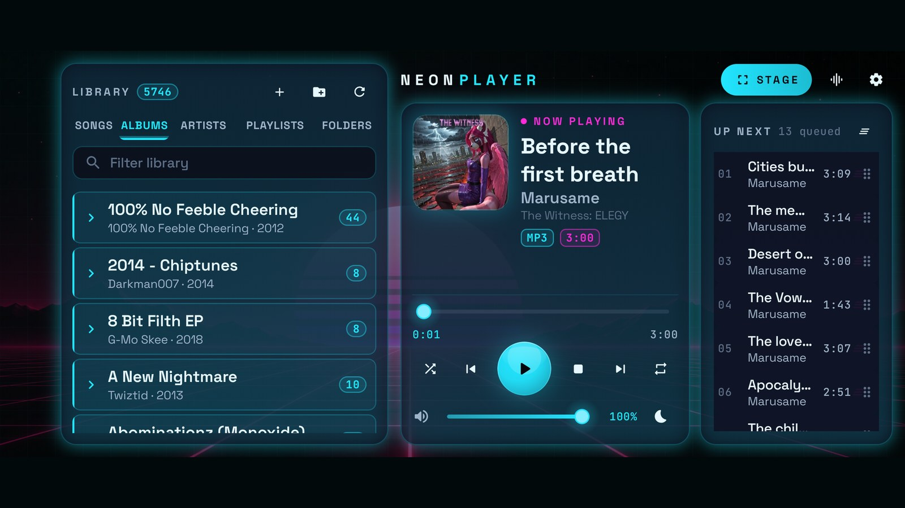
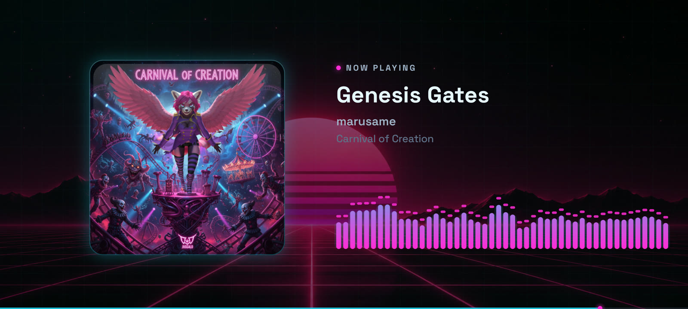
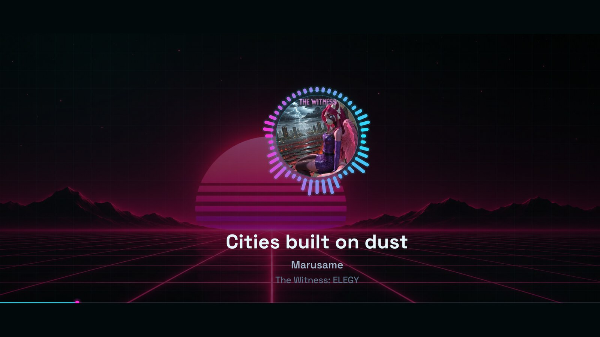
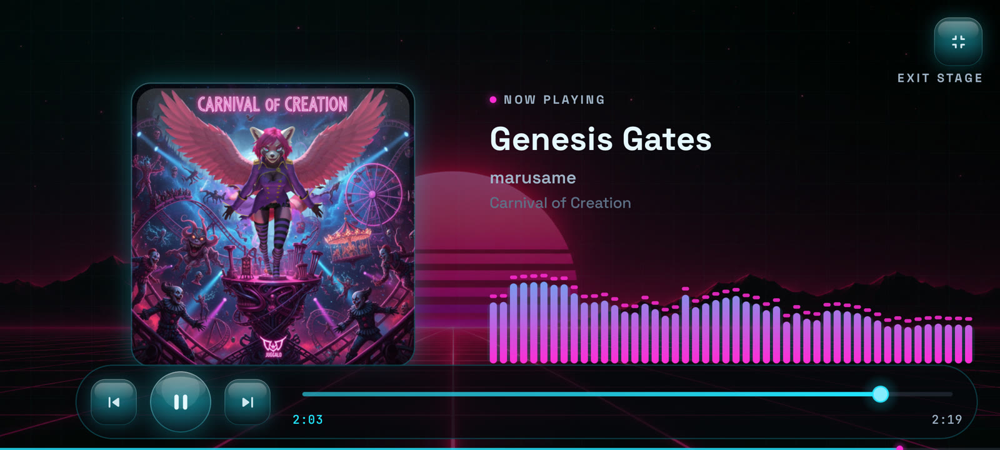
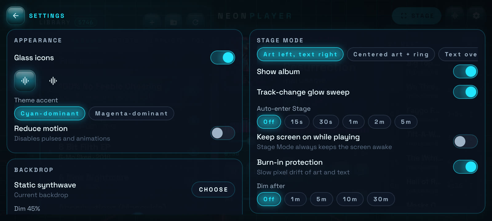

# NeonPlayer

A landscape-first synthwave music player for Android. It's built for a phone propped up sideways with the screen on: album art, title and a live visualizer, with the interface fading out of the way (Stage Mode).

Kotlin · Jetpack Compose (Material3 base, fully custom theme) · Media3 ExoPlayer + MediaSessionService · Room · DataStore · Coil 3.

## Screenshots

Captured on a Pixel 6.



| Stage Mode: art left | Stage Mode: centered art + visualizer ring |
|---|---|
|  |  |
| **Stage Mode: tap to show controls** | **Settings** |
|  |  |

## Download

Grab `NeonPlayer-v1.0.0.apk` from the [latest release](https://github.com/Marusame00/NeonPlayer/releases/latest), open it on your phone and allow "Install unknown apps" for your browser or file manager when Android asks. Android 8.0 (API 26) or newer.

## Build & run

Requirements: Android Studio (recent, with its bundled JBR), Android SDK platform 37.

```bash
# Windows (Git Bash / PowerShell from the project root)
set JAVA_HOME=C:\Program Files\Android\Android Studio\jbr
gradlew.bat assembleDebug
adb install -r app/build/outputs/apk/debug/app-debug.apk
```

Or just open the folder in Android Studio and press Run.

Wireless debugging (e.g. Pixel 6): on the phone, Developer options → Wireless debugging → *Pair device with pairing code*, then

```bash
adb pair <ip>:<pairing-port>      # enter the 6-digit code
adb connect <ip>:<connect-port>
adb install -r app/build/outputs/apk/debug/app-debug.apk
```

- minSdk 26, targetSdk/compileSdk 37
- AGP 9.4 (built-in Kotlin 2.4), KSP for Room, Gradle 9.8 (wrapper included)

Release builds (`gradlew.bat assembleRelease`) are minified with R8. They are signed with the key described in a `keystore.properties` file in the project root (`storeFile`, `storePassword`, `keyAlias`, `keyPassword`). That file and the keystore are gitignored. Without it, release builds fall back to the debug key.

## Permissions

| Permission | Why |
|---|---|
| `READ_MEDIA_AUDIO` (Android 13+) / `READ_EXTERNAL_STORAGE` (≤ 12) | Scan the MediaStore music library |
| `POST_NOTIFICATIONS` (Android 13+) | Media notification / lock-screen controls (optional — playback works without it) |
| `FOREGROUND_SERVICE`, `FOREGROUND_SERVICE_MEDIA_PLAYBACK` | Keep playing in the background |
| `WAKE_LOCK` | Keep the CPU awake during playback |

**No `RECORD_AUDIO`.** The visualizer taps the decoded PCM inside ExoPlayer (`SpectrumAudioProcessor`) and never uses the microphone or `android.media.audiofx.Visualizer`.

Files and folders added through "Files" and "Folder" use the Storage Access Framework with persisted URI permissions, so they need no extra permission.

## Architecture

```
app/src/main/java/com/neonplayer/
├── NeonApp.kt / AppContainer.kt   manual DI, Coil image loader (embedded-art fetcher)
├── MainActivity.kt                single activity, immersive edge-to-edge, permissions, orientation, keep-screen-on
├── domain/model/                  Track, Playlist, AppSettings, enums (pure Kotlin)
├── data/
│   ├── db/                        Room: tracks (indexed), playlists, playlist_entries, queue_items
│   ├── scan/                      MediaStoreScanner, SafImporter + TagReader (MediaMetadataRetriever), M3U
│   ├── repo/                      LibraryRepository, PlaylistRepository, QueueRepository
│   ├── settings/                  DataStore: settings, per-output EQ profiles, last playback state
│   └── art/                       Coil fetcher for embedded/thumbnail album art (downsampled + disk cached)
├── playback/
│   ├── PlaybackService.kt         MediaSessionService + ExoPlayer (audio focus, noisy, gapless, queue restore, ReplayGain, fade)
│   ├── PlayerConnection.kt        MediaController wrapper → StateFlows for the UI
│   ├── SpectrumAudioProcessor.kt  PCM tap → FFT on a background thread → VisualizerBus (allocation-free)
│   ├── EqualizerManager.kt        Equalizer / BassBoost / Virtualizer, presets, saved per output route
│   └── SleepTimer.kt
└── ui/
    ├── theme/Theme.kt             ★ colors, fonts, type scale
    ├── components/                ★ GlassButton / FlatIconButton / NeonIconButton, PlayPauseButton, sliders, cards, badges…
    ├── backdrop/                  static image + looping muted video backdrop (separate ExoPlayer)
    ├── visualizer/                bars, mirrored, radial, oscilloscope, retro grid (Canvas, draw-phase only)
    ├── stage/                     Stage Mode, burn-in drift, dim overlay
    ├── library/  nowplaying/  main/  settings/  eq/
```

## Tweaking the look

**Colors:** `ui/theme/Theme.kt` → `NeonColors` sets the base navy, cyan `#22E5FF`, magenta `#FF2BD6`, pink `#FF3D8F` and the soft text `#E6F7FF`. `paletteFor()` maps the "Theme accent" setting (cyan-dominant or magenta-dominant) onto `primary`/`secondary`. The UI always reads `Neon.palette`, so changing a value there updates the whole app. The launcher icon colors are in `res/values/colors.xml` and `res/drawable/ic_launcher_foreground.xml`.

**Fonts:** `res/font/space_grotesk.ttf` (titles) and `res/font/jetbrains_mono.ttf` (times and badges). Both are OFL variable fonts. The type scale is `NeonType` in `Theme.kt`.

**Glass style:** `ui/components/GlassButton.kt`.
- `GlassButton` is built from these layers, from bottom to top: outer glow (`Modifier.neonGlow`), translucent gradient fill, tint wash, inner shadow, top specular highlight (the white→transparent `specular` brush, alpha `0.38`), and the rim-light stroke. The alphas sit near the top of the draw block, so tune those to make it glassier or subtler.
- `FlatIconButton` is the minimal line-glyph variant.
- `NeonIconButton` chooses between the two based on the global "Glass icons" setting (`LocalNeonStyle`).
- `PlayPauseButton` is the large orb.
- No real-time blur is used anywhere. Everything is layered gradients.

**Cards and glow:** `ui/components/NeonCard.kt` and `Glow.kt` hold the corner radius, border alpha, glow radius and the grid texture.

**Backdrops:** see [`app/src/main/assets/backdrops/README.md`](app/src/main/assets/backdrops/README.md).

## Features at a glance

- Landscape two-pane layout. The left side is the library (Songs, Albums, Artists, Playlists, Folders), with search, sort, collapsible groups and long-press menus. The right side is Now Playing, with art, badges, seek bar, transport, volume, sleep timer and Up Next.
- Portrait layout: library tabs, a mini-player, and a Now Playing sheet that expands from it.
- Queue: drag to reorder, swipe to remove, play next or add to queue, clear. The queue is saved across restarts, along with the track, position, shuffle and repeat state.
- Playlists: create, rename, delete, reorder (both playlists and tracks), add or remove tracks, and import or export M3U.
- Stage Mode: open it with the STAGE button, or have it start automatically after N idle seconds. There are 4 layouts.
  - Tap to show the controls, double-tap to play or pause, swipe left or right to change track, and swipe up to peek at the queue.
  - It keeps the screen awake, drifts pixels slowly to prevent burn-in, can dim after a set number of minutes, and plays a glow sweep on track change.
- Visualizers: spectrum bars, mirrored bars, radial ring, oscilloscope and a bass-reactive retro grid. They can optionally take their colors from the album art.
- Equalizer with presets (Flat, Bass Boost, Vocal, Synthwave, …), plus BassBoost and Virtualizer. Settings are saved separately for speaker, wired and Bluetooth output.
- Video backdrops use a second, muted ExoPlayer. They pause in the background, and Battery saver switches back to the static image.

## Known limitations

- **Crossfade** is a fade-out/fade-in between tracks, not an overlapping mix. A single gapless ExoPlayer can't overlap two tracks. When crossfade is off, playback is gapless.
- **ReplayGain** reads `REPLAYGAIN_TRACK_GAIN`/`ALBUM_GAIN` from Vorbis comments and ID3 TXXX tags and applies the gain in the PCM processor. Files without tags play unchanged.
- The visualizer analyzes audio as it is decoded, which can be a little ahead of what you hear (the audio buffer, roughly 100–200 ms).
- Equalizer, BassBoost and Virtualizer depend on the device's audio effects. Some outputs, such as certain Bluetooth codecs, don't support them.
- "Edit tags" only *displays* the tags (Track info). It does not write them back to the file.

## AI disclosure

NeonPlayer was built with AI assistance. The code, assets pipeline (generated backdrop videos), documentation and on-device testing were produced by **Claude Opus 5.5** running in **Abacus.AI Desktop**, directed and reviewed by the project owner. The included `video.mp4` backdrop, the synthwave background image and the design direction came from the owner's existing NeonAmp / NeonStage apps. Fonts are Space Grotesk and JetBrains Mono (SIL Open Font License).
